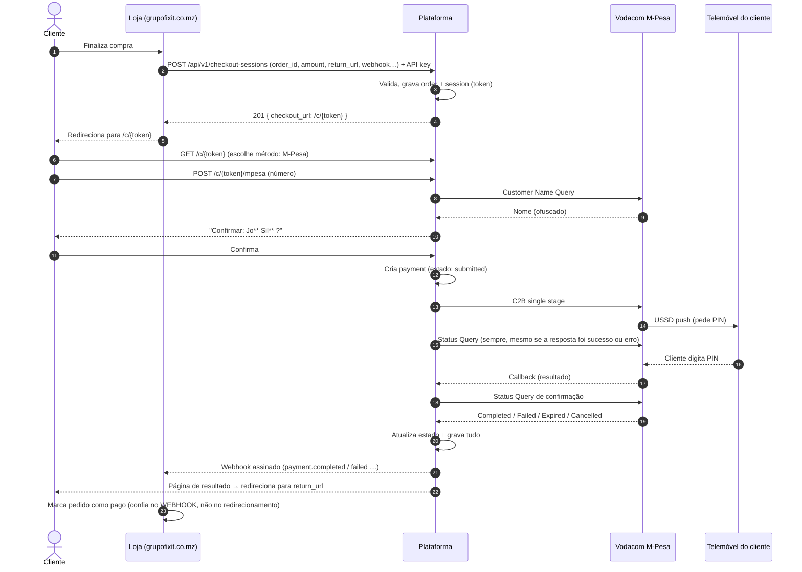
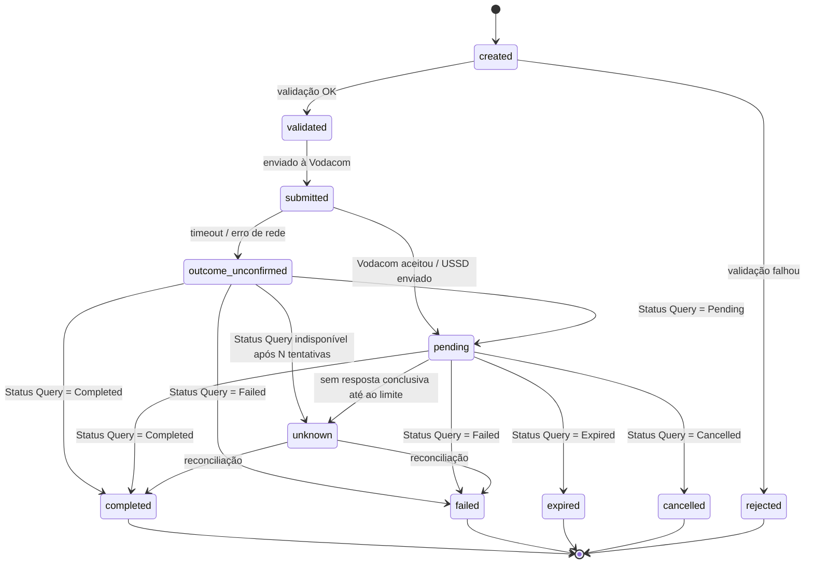

# Plano Mestre: Grupo FixIT Payments

**SDK `grupofixit/mpesa` + Plataforma Central de Pagamentos `pagamento.grupofixit.co.mz`**

> © Grupo FixIT Limitada. Todos os direitos reservados.
> Documento interno de planeamento e especificação. Versão 1.0.
> Licença do código: proprietária (privada), desenvolvido a partir da documentação oficial da Vodacom M-Pesa Moçambique (https://developer.mpesa.vm.co.mz/).

---

## Índice

1. [Visão e objetivos](#1-visão-e-objetivos)
2. [Decisões já tomadas](#2-decisões-já-tomadas)
3. [Escopo](#3-escopo)
4. [Mapa de arquitetura](#4-mapa-de-arquitetura)
5. [Fluxos](#5-fluxos)
6. [Especificação da SDK](#6-especificação-da-sdk-grupofixitmpesa)
7. [Especificação da Plataforma](#7-especificação-da-plataforma)
8. [Segurança e conformidade](#8-segurança-e-conformidade)
9. [Plano de tarefas por fases](#9-plano-de-tarefas-por-fases)
10. [Estratégia de testes](#10-estratégia-de-testes)
11. [Operações e deploy](#11-operações-e-deploy)
12. [Riscos e mitigação](#12-riscos-e-mitigação)
13. [Questões em aberto](#13-questões-em-aberto)
14. [Prompts para Claude Code](#14-prompts-para-claude-code)

---

## 1. Visão e objetivos

Construir **uma infraestrutura própria de pagamentos** do Grupo FixIT, composta por duas peças:

| Peça | O que é |
|---|---|
| **SDK `grupofixit/mpesa`** | Biblioteca PHP própria, independente de framework, que fala com a API M-Pesa Moçambique (Vodacom). Substitui qualquer dependência de SDKs de terceiros. |
| **Plataforma central** | Aplicação Laravel em `pagamento.grupofixit.co.mz`. Recebe pedidos de pagamento das apps internas, valida, executa via SDK, verifica sempre com Status Query, guarda tudo e notifica a app por webhook. Inclui a página pública de checkout. |

### Objetivos

1. **Segurança**: nenhuma dependência de código de terceiros não auditado para mover dinheiro.
2. **Correção**: nenhuma transação é dada como concluída ou falhada sem **confirmação por Transaction Status Query**.
3. **Centralização**: credenciais M-Pesa, ledger, webhooks e reconciliação num único sítio.
4. **Reutilização**: qualquer app interna (PHP, C#, MAUI, Flutter, VB.NET, …) integra via REST + webhook.
5. **Extensibilidade**: arquitetura de gateways para adicionar mKesh, Emola, conta móvel, etc.
6. **Rastreabilidade**: tudo é armazenado (pedidos, pedidos/respostas brutos, estados, eventos, webhooks).

### Princípios inegociáveis

- **Nunca confiar numa única resposta.** Resposta síncrona, callback e redirecionamento do cliente são apenas *sinais*; a verdade vem do Status Query.
- **Nunca repetir uma operação que move dinheiro sem consultar o estado antes.**
- **Nunca pedir ou guardar o PIN do cliente.** O PIN é digitado no telemóvel, via USSD push.
- **Valores nunca viajam por URL**; vêm sempre do backend da app (server-to-server).
- **TLS sempre verificado.**
- **Idempotência em tudo** o que cria pagamentos.

---

## 2. Decisões já tomadas

| # | Decisão | Detalhe |
|---|---|---|
| D1 | Serviço central (não SDK por app) | Apps enviam pedidos à plataforma; a plataforma fala com a Vodacom |
| D2 | Sem multi-cliente | Uso exclusivo do Grupo FixIT; uma conta M-Pesa por ambiente |
| D3 | API key por app | Cada software integrado tem a sua chave, revogável e com permissões |
| D4 | Resultado por webhook, por app | Cada app tem o seu URL de webhook (+ consulta `GET` como reserva) |
| D5 | Ambientes sandbox/live | Credenciais M-Pesa configuradas uma vez por ambiente |
| D6 | **Interruptor de ambiente por app** | A mesma API key serve sandbox e live; muda-se o ambiente no painel, sem reconfigurar |
| D7 | Plataforma = Laravel (PHP 8.3) | PHP 8.3 em produção; não é necessário 8.4 |
| D8 | SDK própria primeiro | Desenvolvida a partir da documentação oficial da Vodacom; licença própria |
| D9 | Nome do pacote | Composer: `grupofixit/mpesa` · Namespace PHP: `GrupoFixIT\Mpesa` |
| D10 | Domínio | `pagamento.grupofixit.co.mz` (singular) · API em `/api/v1` no mesmo domínio |
| D11 | Checkout com marca fixa Grupo FixIT | Sem personalização por app |
| D12 | Métodos de pagamento | M-Pesa agora; mKesh, Emola, conta móvel no futuro (interface `PaymentGateway`) |
| D13 | Customer Name Query | Executado antes de cobrar; resultado (nome ofuscado) é guardado |
| D14 | Tudo é armazenado | Incluindo ID da transação M-Pesa, ConversationID e respostas brutas (com segredos mascarados) |
| D15 | Fluxo obrigatório | Pedido → validação → envio ao M-Pesa → análise → **Status Query sempre** → resposta final |

---

## 3. Escopo

### Dentro do escopo (v1)

- SDK com: **C2B, B2C, B2B, Transaction Status Query, Customer Name Query, Reversal/Refund** (total e parcial), parser de callbacks da Vodacom.
- Plataforma com: API para apps, checkout público, webhooks de entrada (Vodacom) e saída (apps), ledger, jobs de Status Query e reconciliação, painel de administração, auditoria.
- Bibliotecas cliente finas para as apps (PHP/Laravel, .NET, Dart), geradas a partir de OpenAPI.

### Fora do escopo (v1)

- Multi-tenant / clientes externos.
- Outros gateways (mKesh, Emola, …): apenas preparar a interface.
- Pagamentos por cartão.
- Direct Debit (confirmar com a Vodacom se está disponível para a vossa conta antes de planear).

---

## 4. Mapa de arquitetura

```
┌────────────────────────────────────────────────────────────────────────┐
│                          APPS INTERNAS (clientes)                      │
│  grupofixit.co.mz (Laravel) · C# · MAUI · Flutter · VB.NET · outras    │
│  (apps móveis chamam o SEU backend; nunca guardam a API key da central) │
└───────────────┬───────────────────────────────────▲────────────────────┘
                │ HTTPS + API key (server-to-server) │ Webhook assinado (HMAC)
                ▼                                    │
┌────────────────────────────────────────────────────┴────────────────────┐
│            PLATAFORMA  ·  pagamento.grupofixit.co.mz  (Laravel)         │
│                                                                         │
│  ┌──────────────┐  ┌──────────────┐  ┌───────────────┐  ┌────────────┐  │
│  │ API /api/v1  │  │ Checkout     │  │ Webhook IN    │  │ Painel     │  │
│  │ (apps)       │  │ /c/{token}   │  │ (Vodacom)     │  │ Admin      │  │
│  └──────┬───────┘  └──────┬───────┘  └──────┬────────┘  └─────┬──────┘  │
│         └─────────┬───────┴─────────────────┘                  │         │
│                   ▼                                            │         │
│        ┌─────────────────────┐   ┌──────────────────────────┐  │         │
│        │ Núcleo de Pagamentos│◄──┤ Filas / Jobs (Horizon)   │  │         │
│        │ (estados, ledger,   │   │ StatusQuery · Webhooks   │  │         │
│        │  idempotência)      │   │ Reconciliação · Expiração│  │         │
│        └─────────┬───────────┘   └──────────────────────────┘  │         │
│                  ▼                                              │         │
│        ┌─────────────────────┐          ┌────────────────────┐  │         │
│        │ PaymentGateway      │          │ Base de dados      │◄─┘         │
│        │ (interface)         │          │ MySQL/PostgreSQL   │            │
│        └─────────┬───────────┘          │ + Redis (cache/fila)│           │
│                  ▼                      └────────────────────┘            │
│        ┌─────────────────────┐                                            │
│        │ MpesaGateway        │  futuros: MkeshGateway, EmolaGateway…      │
│        │ usa SDK             │                                            │
│        └─────────┬───────────┘                                            │
└──────────────────┼────────────────────────────────────────────────────────┘
                   ▼
        ┌──────────────────────┐        ┌───────────────────────────┐
        │ SDK grupofixit/mpesa │───────►│ Vodacom M-Pesa API        │
        │ (pacote Composer)    │◄───────│ sandbox: api.sandbox.vm.co.mz │
        └──────────────────────┘ callback│ live:    api.vm.co.mz        │
                                         └───────────────────────────┘
```

### Repositórios

| Repositório | Conteúdo | Visibilidade |
|---|---|---|
| `grupofixit/mpesa` | SDK PHP (Composer) | Privado |
| `grupofixit/payments-platform` | Plataforma Laravel | Privado |
| `grupofixit/payments-clients` | Clientes finos (PHP, .NET, Dart) + OpenAPI | Privado |

---

## 5. Fluxos

### 5.1 Checkout completo (C2B), visão do cliente



### 5.2 Máquina de estados do pagamento



**Regras:**
- Estados finais: `completed`, `failed`, `expired`, `cancelled`, `rejected`. Só `unknown` pode transitar para um final por reconciliação.
- **Só se passa a `failed`/`expired`/`cancelled` com confirmação do Status Query.**
- `unknown` gera **alerta** e entra na fila de revisão manual no painel.
- Reversões são **registos separados** (tipo `reversal`) ligados ao pagamento original; o pagamento original mantém-se `completed`, com campo `reversed_amount`.

### 5.3 Regra de ouro: Status Query em todas as respostas

```
Resposta da Vodacom (qualquer) ──► grava resposta bruta
                                  │
                                  ▼
                       agenda StatusQuery imediato
                                  │
        ┌─────────────────────────┼──────────────────────────┐
        ▼                         ▼                          ▼
  Terminal (Completed/      Pending / N/A              Erro do próprio
  Failed/Expired/Cancelled)  → re-agenda com backoff   Status Query
  → fecha o pagamento         5s,10s,20s,40s,60s,      → retry; após limite
  → webhook para a app        depois a cada 60s até    → estado `unknown` + alerta
                              ao limite de expiração
```

### 5.4 Callback da Vodacom (webhook de entrada)

1. `POST /webhooks/mpesa/{env}/{secret}` recebe o payload (`input_OriginalConversationID`, `input_ThirdPartyReference`, `input_TransactionID`, `input_ResultCode`, `input_ResultDesc`).
2. **Grava imediatamente** o payload bruto em `incoming_callbacks` (nunca se perde).
3. **Responde logo** no formato exigido (`output_OriginalConversationID`, `output_ResponseCode`, `output_ResponseDesc`, `output_ThirdPartyConversationID`).
4. **Não confia no conteúdo**: agenda o Status Query do pagamento correspondente e só atualiza o estado com o resultado dele.
5. Callbacks duplicados ou sem pagamento correspondente são registados e ignorados com alerta.

### 5.5 Webhook de saída (plataforma → app)

- Eventos: `payment.pending`, `payment.completed`, `payment.failed`, `payment.expired`, `payment.cancelled`, `payment.unknown`, `reversal.completed`, `reversal.failed`.
- Cabeçalhos: `X-FixIT-Event`, `X-FixIT-Event-Id`, `X-FixIT-Timestamp`, `X-FixIT-Signature: v1=<HMAC-SHA256(timestamp + "." + body, secret_da_app)>`.
- A app valida a assinatura, rejeita timestamps com mais de 5 minutos e **deduplica por `event_id`**.
- Resposta `2xx` = entregue. Caso contrário, retries: 1 min, 5 min, 15 min, 1 h, 6 h, 24 h (depois `failed` + alerta). Reenvio manual no painel.
- Payload inclui `environment` (`sandbox` ou `live`).

### 5.6 B2C / B2B (pagamentos para fora)

1. Apenas via API server-to-server, com permissão `b2c` / `b2b` na API key.
2. Validação de limites (por transação, por dia, por app) e de saldo/permissões.
3. Cria payment (`submitted`) → envia → **se timeout: NUNCA reenviar**, passar a `outcome_unconfirmed` e consultar o estado.
4. Status Query sempre, como no 5.3.
5. (Configurável) aprovação dupla para valores acima de um limite: ver questão aberta Q4.

### 5.7 Reversão / Refund

1. `POST /api/v1/payments/{id}/reversals` (permissão `reversal`; valor opcional para parcial).
2. Só pagamentos `completed` e dentro do valor ainda reversível.
3. Cria registo `reversal` → chama Reversal API (PUT) → Status Query de confirmação → atualiza e notifica por webhook.
4. Registo de auditoria com quem pediu (app + utilizador, se aplicável).

### 5.8 Reconciliação

- **A cada 5 min**: pagamentos `pending`/`outcome_unconfirmed`/`unknown` antigos → Status Query.
- **Diária**: todos os `completed` das últimas 48 h reconfirmados por Status Query; relatório de discrepâncias (`reconciliation_runs`).
- Alertas (email/Slack/WhatsApp interno) para: `unknown`, discrepâncias, webhooks falhados, picos de erro da Vodacom.

### 5.9 Troca de ambiente (sandbox ↔ live)

1. Credenciais M-Pesa guardadas por ambiente em `mpesa_credentials` (cifradas), configuradas uma vez.
2. Cada app tem `environment` (`sandbox` | `live`). A API key é a mesma.
3. Para passar a `live`: a app tem de estar marcada `live_approved`, existirem credenciais live completas, confirmação explícita no painel (2FA) e fica em auditoria.
4. Todas as respostas e webhooks incluem `environment`. Dados de sandbox e live nunca se misturam (coluna `environment` em todas as tabelas de transações e filtro global).

---

## 6. Especificação da SDK `grupofixit/mpesa`

### 6.1 Requisitos

- PHP `^8.3`, extensões `ext-openssl`, `ext-json`.
- **Sem dependência do Laravel.** Dependências mínimas: `psr/http-client`, `psr/http-factory`, `psr/http-message`, `psr/log`, `psr/simple-cache`. Implementação HTTP à escolha do consumidor (Guzzle ou Symfony HttpClient) via PSR-18; incluir adaptador opcional.
- Namespace `GrupoFixIT\Mpesa`. Autoload PSR-4.
- Código tipado estritamente (`declare(strict_types=1)`), classes `readonly`, enums, sem `mixed` desnecessário.
- Qualidade: PHPStan nível máximo, PHP-CS-Fixer/Pint, PHPUnit ≥ 90 % de cobertura nas classes de domínio.

### 6.2 Endpoints da Vodacom (validar contra a documentação oficial antes de implementar)

| Operação | Método | Path | Porta | Notas |
|---|---|---|---|---|
| C2B single stage | POST | `/ipg/v1x/c2bPayment/singleStage/` | 18352 | USSD push ao cliente |
| B2C | POST | `/ipg/v1x/b2cPayment/` | 18345 | |
| B2B | POST | `/ipg/v1x/b2bPayment/` | 18349 | |
| Transaction Status | GET | `/ipg/v1x/queryTransactionStatus/` | 18353 | query string |
| Reversal | PUT | `/ipg/v1x/reversal/` | 18354 | corpo JSON |
| Customer Name | GET | `/ipg/v1x/queryCustomerName/` | 19323 | **confirmar na doc oficial** |

- Hosts: sandbox `https://api.sandbox.vm.co.mz` · live `https://api.vm.co.mz` (**confirmar**).
- Cabeçalhos: `Content-Type: application/json`, `Authorization: Bearer <token>`, `Origin: developer.mpesa.vm.co.mz`.
- **Token**: API key cifrada com a chave pública RSA da Vodacom (PKCS#1 v1.5) e codificada em base64 (**confirmar** algoritmo/padding e eventual validade na doc oficial). Falha de cifragem tem de lançar exceção, nunca produzir token vazio.
- Campos de pedido (`input_*`) e resposta (`output_*`): seguir a documentação oficial; os já conhecidos incluem `TransactionReference`, `CustomerMSISDN`, `Amount`, `ThirdPartyReference`, `ServiceProviderCode`, `PrimaryPartyCode`, `ReceiverPartyCode`, `QueryReference`, `TransactionID`, `SecurityCredential`, `InitiatorIdentifier`, `ReversalAmount`.
- Restrições conhecidas: `TransactionReference` entre 1 e 20 caracteres; `ThirdPartyReference` único.
- **Regra**: onde a documentação oficial for ambígua ou contraditória (ex.: tabelas de códigos `INS-*`), **não assumir**: marcar `TODO(VODACOM-DOC)`, tratar como código desconhecido (que dispara Status Query) e levantar na secção Q.

### 6.3 Estrutura de pastas

```
grupofixit-mpesa/
├── composer.json
├── README.md · CHANGELOG.md · LICENSE (proprietária) · SECURITY.md
├── phpstan.neon · phpunit.xml.dist · pint.json
├── .github/workflows/ci.yml           # PHP 8.3 (+8.4), phpstan, pint, phpunit, composer audit
├── src/
│   ├── MpesaClient.php                # ponto de entrada
│   ├── Config/
│   │   ├── MpesaConfig.php            # readonly; ambiente + credenciais + opções
│   │   ├── Credentials.php            # apiKey, publicKey, serviceProviderCode, initiator*, securityCredential
│   │   └── EnvironmentRegistry.php    # sandbox/live → base URL + portas
│   ├── Enums/
│   │   ├── Environment.php            # Sandbox | Live
│   │   ├── Operation.php              # C2B | B2C | B2B | Status | CustomerName | Reversal
│   │   ├── ResponseCode.php           # catálogo INS-* + Unknown
│   │   └── TransactionStatus.php      # Completed|Pending|Cancelled|Expired|Failed|NotAvailable|Unknown
│   ├── Auth/
│   │   ├── TokenGenerator.php         # RSA/OpenSSL
│   │   └── TokenProvider.php          # interface (+ CachedTokenProvider via PSR-16)
│   ├── Http/
│   │   ├── Transport.php              # PSR-18, TLS verificado, timeouts, logging mascarado
│   │   ├── RetryPolicy.php            # só para operações idempotentes de leitura
│   │   └── Endpoint.php               # path+porta+método por Operation
│   ├── Requests/                      # DTOs readonly validados
│   │   ├── C2BRequest.php · B2CRequest.php · B2BRequest.php
│   │   ├── TransactionStatusRequest.php · CustomerNameRequest.php · ReversalRequest.php
│   ├── Responses/
│   │   ├── MpesaResponse.php          # base: http status, código, descrição, bruto (mascarado)
│   │   ├── TransactionResult.php · TransactionStatusResult.php
│   │   ├── CustomerNameResult.php · ReversalResult.php
│   ├── Callback/
│   │   ├── CallbackParser.php         # payload Vodacom → CallbackPayload
│   │   ├── CallbackPayload.php
│   │   └── CallbackAcknowledgement.php# resposta exigida pela Vodacom
│   ├── Exceptions/
│   │   ├── MpesaException.php (base)
│   │   ├── ValidationException.php · ConfigurationException.php · AuthenticationException.php
│   │   ├── ApiException.php           # erro devolvido pela Vodacom (com código tipado)
│   │   ├── TransportException.php     # rede/TLS
│   │   └── OutcomeUnknownException.php# timeout/ambiguidade em operação que move dinheiro
│   ├── Support/
│   │   ├── Money.php                  # valor decimal positivo, máx. 2 casas, MZN
│   │   ├── Msisdn.php                 # normalização e validação 258…
│   │   ├── Reference.php              # gerador de referências ≤ 20 chars alfanuméricos únicos
│   │   └── Redactor.php               # mascara segredos em logs/payloads
│   └── Testing/
│       ├── FakeTransport.php · FakeMpesa.php   # para testes das apps sem rede
│       └── Fixtures/                  # respostas exemplo
└── tests/
    ├── Unit/ …                        # cada classe de domínio
    ├── Contract/                      # fixtures por operação
    └── Integration/                   # contra sandbox; saltados sem credenciais em env
```

### 6.4 API pública (exemplo de uso)

```php
$mpesa = MpesaClient::create(new MpesaConfig(
    environment: Environment::Sandbox,
    credentials: $credentials,          // Credentials(readonly)
    httpClient: $psr18,                 // opcional
    logger: $psr3,                      // opcional
    cache: $psr16,                      // opcional (token)
));

$result = $mpesa->c2b(new C2BRequest(
    transactionReference: Reference::generate(),
    customerMsisdn: Msisdn::from('258841234567'),
    amount: Money::mzn('100.00'),
    thirdPartyReference: Reference::generate(),
));

$status = $mpesa->transactionStatus(new TransactionStatusRequest(
    thirdPartyReference: $ref,
    queryReference: $result->conversationId,
));

$name = $mpesa->customerName(new CustomerNameRequest(Msisdn::from('258841234567'), $ref2));
```

### 6.5 Regras de comportamento da SDK

1. **Validar sempre antes de enviar**: todas as operações, não só C2B.
2. **TLS sempre verificado**; não existe opção para o desligar.
3. **Timeouts** configuráveis (defeito: ligação 10 s, total 60 s, **confirmar limites da Vodacom**).
4. **Retries**: apenas em operações de leitura (Status, CustomerName) e só em erros de rede/5xx. **Operações que movem dinheiro (C2B, B2C, B2B, Reversal) nunca têm retry automático.**
5. Se uma operação que move dinheiro der timeout/erro ambíguo → lançar `OutcomeUnknownException` com `thirdPartyReference`, para o chamador fazer Status Query.
6. **Códigos desconhecidos** → `ResponseCode::Unknown`, nunca sucesso presumido. Sucesso = **apenas** o código de sucesso oficial.
7. Respostas HTTP não-2xx e corpo não-JSON nunca podem quebrar com `TypeError`; são convertidas em exceções tipadas.
8. **Redação** automática de `apiKey`, `securityCredential`, `Authorization`, token e números de telefone parcialmente (`2588****567`) em logs.
9. Sem estado global, sem singletons ocultos; token em cache via PSR-16 (com TTL configurável e invalidação em `401`).
10. Versionamento SemVer; `CHANGELOG.md` obrigatório.

### 6.6 Catálogo de códigos

Construir `ResponseCode` (enum com descrição PT/EN e classificação: `success`, `retryable`, `client_error`, `final_failure`, `needs_review`) a partir da **tabela oficial da Vodacom**. Se houver tabelas conflitantes, usar a oficial e anotar discrepâncias em `docs/response-codes.md`.

---

## 7. Especificação da Plataforma

### 7.1 Stack

- Laravel (última estável compatível com PHP 8.3), PHP 8.3.
- BD: MySQL 8+/MariaDB ou PostgreSQL (o que a infraestrutura suportar); Redis para fila/cache; Laravel Horizon (ou `database` queue como alternativa mínima).
- Painel admin: Filament (ou equivalente) com 2FA obrigatório.
- Testes: Pest ou PHPUnit; Larastan; Pint.
- Frontend do checkout: Blade + Alpine/Livewire (leve, sem SPA), responsivo mobile-first, **marca Grupo FixIT**.

### 7.2 Módulos

| Módulo | Responsabilidade |
|---|---|
| `Apps` | Apps clientes, API keys, permissões, limites, webhook URL/secret, ambiente |
| `Auth` | Autenticação por API key (`Authorization: Bearer fx_…`), rate limiting, auditoria |
| `Orders` | Pedidos recebidos das apps (order_id, valor, moeda, metadados) |
| `Checkout` | Sessões, páginas públicas, escolha de método, confirmação de nome, estado em tempo real |
| `Payments` | Núcleo: máquina de estados, ledger, idempotência, eventos |
| `Gateways` | `PaymentGateway` (interface) + `MpesaGateway` (usa a SDK) |
| `Webhooks` | Entrada (Vodacom) e saída (apps): assinatura, entregas, retries |
| `Reconciliation` | Jobs de Status Query, expiração, relatórios de discrepâncias |
| `Customers` | Registos de Customer Name Query (nome ofuscado + MSISDN) |
| `Admin` | Painel: apps, keys, ambientes, credenciais M-Pesa, pagamentos, fila de revisão, webhooks |
| `Audit` | Log imutável de ações sensíveis |

### 7.3 API para as apps (`/api/v1`)

Autenticação: `Authorization: Bearer <api_key>`. Respostas JSON. Todas as criações exigem cabeçalho `Idempotency-Key`.

| Método | Rota | Permissão | Descrição |
|---|---|---|---|
| POST | `/checkout-sessions` | `checkout` | Cria order + sessão; devolve `checkout_url` e `expires_at` |
| GET | `/checkout-sessions/{id}` | `checkout` | Estado da sessão |
| GET | `/payments/{id}` | `read` | Estado completo do pagamento |
| GET | `/payments?order_id=` | `read` | Lista/filtra pagamentos da app |
| POST | `/payments/c2b` | `c2b` | Cobrança direta (sem checkout), para integrações especiais |
| POST | `/payments/b2c` | `b2c` | Pagamento a cliente |
| POST | `/payments/b2b` | `b2b` | Pagamento entre negócios |
| POST | `/payments/{id}/reversals` | `reversal` | Reversão total/parcial |
| POST | `/payments/{id}/refresh` | `read` | Força Status Query |
| GET | `/customers/name?msisdn=` | `customer_name` | Customer Name Query |
| GET | `/me` | qualquer | Dados da app e ambiente atual |

**Exemplo: criar sessão de checkout**

```json
POST /api/v1/checkout-sessions
Idempotency-Key: 7c9e…
{
  "order_id": "12345678",
  "amount": "1500.00",
  "currency": "MZN",
  "description": "Compra #12345678",
  "return_url": "https://grupofixit.co.mz/pedidos/12345678/resultado",
  "cancel_url": "https://grupofixit.co.mz/carrinho",
  "customer": { "name": "…", "email": "…", "msisdn": "258…" },
  "metadata": { "qualquer": "coisa" }
}
→ 201
{
  "id": "cs_01J…",
  "checkout_url": "https://pagamento.grupofixit.co.mz/c/9fK3…",
  "expires_at": "2026-…",
  "environment": "sandbox"
}
```

Regras: `order_id` único por app (um order já pago não pode ser pago de novo); `return_url`/`cancel_url` validados contra uma allow-list de domínios da app; `amount` só decimal com 2 casas; erros no formato `{ "error": { "code", "message", "details" } }`.

### 7.4 Páginas de checkout (públicas)

| Rota | Descrição |
|---|---|
| `GET /c/{token}` | Resumo (descrição, valor) + escolha do método (M-Pesa; futuros mKesh/Emola…) |
| `GET /c/{token}/mpesa` | Formulário do número M-Pesa |
| `POST /c/{token}/mpesa/lookup` | Customer Name Query → mostra nome ofuscado para confirmar |
| `POST /c/{token}/mpesa/pay` | Inicia o C2B |
| `GET /c/{token}/status` | JSON para polling do estado (a página mostra "Confirme no seu telemóvel") |
| `GET /c/{token}/result` | Resultado final + botão/redirect para `return_url` |

Regras: token aleatório ≥ 32 bytes, de uso limitado e com expiração (defeito 30 min); **nenhum valor ou ID sensível na URL**; CSRF; rate limiting por IP e por MSISDN; CSP restritiva; **nunca existe campo de PIN**; o `return_url` do redirecionamento leva apenas `payment_id` e `status` informativo (a app confirma por webhook/`GET`).

### 7.5 Modelo de dados (principais tabelas)

| Tabela | Campos-chave |
|---|---|
| `apps` | id, name, slug, environment, live_approved, webhook_url, webhook_secret(enc), allowed_return_domains, limits (json), active |
| `api_keys` | id, app_id, prefix, key_hash, permissions (json), last_used_at, revoked_at |
| `mpesa_credentials` | id, environment, api_key(enc), public_key, service_provider_code, initiator_identifier, security_credential(enc), base_url, active |
| `orders` | id, app_id, environment, external_order_id (unique por app+env), amount, currency, description, customer (json), metadata (json), status |
| `checkout_sessions` | id, order_id, token_hash, status, expires_at, selected_method, return_url, cancel_url |
| `payments` | id (public `pay_…`), app_id, order_id?, environment, type (c2b/b2c/b2b/reversal), gateway, amount, currency, msisdn, state, mpesa_transaction_id, mpesa_conversation_id, third_party_reference (unique), transaction_reference (≤20, unique), parent_payment_id, reversed_amount, idempotency_key, failure_reason, timestamps |
| `payment_events` | id, payment_id, from_state, to_state, source (api/callback/statusquery/reconciliation/admin), payload (json), created_at |
| `gateway_requests` | id, payment_id, operation, request (json mascarado), response (json mascarado), http_status, response_code, duration_ms, created_at |
| `incoming_callbacks` | id, environment, payload bruto, headers, received_at, processed_at, matched_payment_id |
| `customer_lookups` | id, environment, msisdn, first_name_masked, second_name_masked, response (json), payment_id?, created_at |
| `webhook_deliveries` | id, app_id, payment_id, event_id (uuid), event_type, payload, attempt, status, http_status, response_body (truncado), next_retry_at |
| `idempotency_keys` | id, app_id, key, request_hash, response (json), created_at (unique app_id+key) |
| `reconciliation_runs` | id, environment, started_at, finished_at, checked, discrepancies (json) |
| `audit_logs` | id, actor_type, actor_id, action, subject, before/after (json), ip, created_at |

Regras: todas as tabelas de transações têm `environment` e filtro global por ambiente; valores monetários `DECIMAL(15,2)`; nunca apagar (soft-state); índices em referências, estado e datas; `payment_events` e `audit_logs` são só-de-acrescentar.

### 7.6 Jobs e agendamentos

| Job | Quando | O que faz |
|---|---|---|
| `SubmitPaymentJob` | ao criar pagamento | Envia à Vodacom via SDK; trata `OutcomeUnknownException` |
| `StatusQueryJob` | depois de cada resposta/callback + backoff | Consulta e aplica transição de estado |
| `ProcessCallbackJob` | ao receber callback | Casa com pagamento e agenda `StatusQueryJob` |
| `DeliverWebhookJob` | por evento | Entrega com assinatura + retries |
| `ExpirePaymentsJob` | a cada minuto | Fecha sessões/pagamentos fora de prazo (após Status Query final) |
| `ReconcilePendingJob` | a cada 5 min | Re-consulta pendentes/unknown antigos |
| `DailyReconciliationJob` | diário | Reconfirma `completed` recentes; relatório |
| `PruneJob` | diário | Rotação de logs técnicos (nunca ledger) |

### 7.7 Painel de administração

- Dashboard (volume, taxa de sucesso, pendentes, `unknown`, falhas de webhook).
- Apps: criar, gerar/rodar/revogar API key (mostrada **uma só vez**), permissões, limites, webhook URL, **interruptor de ambiente** (com confirmação + 2FA).
- Credenciais M-Pesa por ambiente (cifradas; só edição, nunca leitura em claro).
- Pagamentos: pesquisa, detalhe completo (timeline de eventos, pedidos/respostas), botão "Forçar Status Query".
- Fila de revisão (`unknown`/discrepâncias) com resolução manual auditada.
- Webhooks: entregas, reenvio manual.
- Utilizadores admin com papéis (Admin, Financeiro, Só leitura) e 2FA obrigatório.

---

## 8. Segurança e conformidade

| Área | Requisito |
|---|---|
| **PIN / dados sensíveis** | O sistema nunca pede, recebe nem guarda o PIN. Nenhum dado de cartão. |
| **TLS** | Verificação de certificado sempre ativa (SDK e plataforma). HSTS no domínio. |
| **API keys** | Formato `fx_<random 40+ chars>`; mostrada uma vez; guardada só como hash; comparação em tempo constante; revogação imediata; rotação sem downtime (duas keys ativas em simultâneo por app). |
| **Credenciais M-Pesa** | Cifradas em repouso (cifra da aplicação com chave fora da BD); nunca em logs; acesso restrito a admins; alteração auditada. |
| **Permissões** | Por key: `checkout`, `read`, `c2b`, `b2c`, `b2b`, `reversal`, `customer_name`. B2C, B2B e reversão desligados por defeito. |
| **Limites** | Por app: valor máximo por transação, por dia, nº de pedidos por minuto; configuráveis no painel. |
| **Idempotência** | `Idempotency-Key` obrigatória; `order_id` único; `third_party_reference` único; nunca cobrar duas vezes o mesmo order. |
| **Webhooks** | HMAC-SHA256 + timestamp, janela de 5 min, `event_id` para deduplicar; secret por app, rodável. Callback da Vodacom em URL com segredo no caminho (+ IP allow-list se a Vodacom fornecer IPs) e **sempre confirmado por Status Query**. |
| **Checkout** | Tokens aleatórios e expiráveis; CSRF; CSP; rate limiting por IP/MSISDN; sem valores na URL; `return_url` validado contra allow-list. |
| **Apps móveis (MAUI/Flutter)** | **Nunca** embutir a API key da plataforma. A app móvel chama o backend da própria app, e este chama a plataforma. |
| **Logs** | Estruturados, com redação automática de segredos e MSISDN parcialmente mascarado. |
| **Dados pessoais** | MSISDN e nome (ofuscado) tratados como dados pessoais: guardar o mínimo, acesso restrito, política de retenção definida, cópias de segurança cifradas. Avaliar requisitos legais aplicáveis (Moçambique e, se houver tratamento na África do Sul, POPIA). |
| **Auditoria** | Log só-de-acrescentar para: criação/revogação de keys, troca de ambiente, alteração de credenciais, reversões, resoluções manuais. |
| **Cadeia de fornecimento** | `composer.lock` versionado, versões fixas, `composer audit` no CI, dependências mínimas, repositórios privados com 2FA e revisão obrigatória de PRs, Dependabot/Renovate. |
| **Backups** | Diários, cifrados, com teste de restauro periódico. |
| **Admin** | 2FA obrigatório, papéis, sessão curta, IP allow-list opcional. |

---

## 9. Plano de tarefas por fases

> Convenção: `[ ]` por fazer. Cada tarefa tem **ID**, **descrição** e **critério de aceitação (CA)**.
> Ordem: **Fase 0 → 1 (SDK) → 2 → 3 → 4 → 5 → 6 → 7**. Fases 2 a 5 correspondem à plataforma.

### Fase 0: Preparação

- [ ] **P-01** Criar repositórios privados (`mpesa`, `payments-platform`, `payments-clients`) com branch protection, PR obrigatório e 2FA. *CA: regras ativas.*
- [ ] **P-02** Obter credenciais **sandbox** no portal Vodacom (API key, public key, service provider code) e registar no gestor de segredos. *CA: chamada de teste manual bem-sucedida.*
- [ ] **P-03** Ler a documentação oficial e criar `docs/vodacom-notes.md` (endpoints, campos, códigos, validade do token, timeouts). *CA: todos os "confirmar" da secção 6.2 resolvidos.*
- [ ] **P-04** Pedir à Vodacom: URL de callback (sandbox/live), IPs de origem, limites, janela de expiração do USSD. *CA: respostas arquivadas.*
- [ ] **P-05** Definir padrões: PHPStan máx., Pint, convenção de commits, CI base. *CA: pipeline verde num esqueleto vazio.*

### Fase 1: SDK `grupofixit/mpesa`

- [ ] **S-01** Esqueleto do pacote (composer, PSR-4, CI, LICENSE proprietária, README). *CA: `composer install` + CI verde.*
- [ ] **S-02** Enums (`Environment`, `Operation`, `TransactionStatus`) e `EnvironmentRegistry`. *CA: testes unitários.*
- [ ] **S-03** Value objects `Money`, `Msisdn`, `Reference`, `Redactor`. *CA: testes de limites/normalização/unicidade; ≥ 95 %.*
- [ ] **S-04** `Credentials` + `MpesaConfig` com validação. *CA: config inválida lança `ConfigurationException`.*
- [ ] **S-05** `TokenGenerator` (RSA) + `TokenProvider` com cache PSR-16 e invalidação em 401. *CA: falha de cifragem lança exceção; teste com par de chaves de teste.*
- [ ] **S-06** `Transport` PSR-18 (TLS verificado, timeouts, logging mascarado) + `Endpoint`. *CA: testes com `FakeTransport`; impossível desativar a verificação TLS.*
- [ ] **S-07** `ResponseCode` (catálogo oficial) e `MpesaResponse` base com parsing seguro. *CA: JSON inválido/HTML/vazio não geram TypeError.*
- [ ] **S-08** `C2BRequest/Result` + `MpesaClient::c2b`. *CA: contrato por fixtures; validação completa.*
- [ ] **S-09** `TransactionStatus` (request/result/enum). *CA: todos os estados mapeados; desconhecido → `Unknown`.*
- [ ] **S-10** `CustomerName`. *CA: nomes ofuscados lidos corretamente.*
- [ ] **S-11** `B2C` e `B2B`. *CA: sem retry automático; validação completa.*
- [ ] **S-12** `Reversal` (total/parcial). *CA: valor opcional; validações de credenciais.*
- [ ] **S-13** `OutcomeUnknownException` e política de retry (só leituras). *CA: testes de timeout em C2B/B2C/B2B/Reversal nunca reenviam.*
- [ ] **S-14** `CallbackParser` + `CallbackAcknowledgement`. *CA: resposta no formato exato exigido.*
- [ ] **S-15** `FakeMpesa`/`FakeTransport` + fixtures públicas para as apps testarem. *CA: exemplo de teste documentado.*
- [ ] **S-16** Testes de integração contra o sandbox (saltados sem env). *CA: C2B, Status, CustomerName, Reversal passam no sandbox.*
- [ ] **S-17** Documentação (README, exemplos, `docs/response-codes.md`, `docs/security.md`), CHANGELOG, tag `v1.0.0`. *CA: release privada instalável via Composer.*

**Marco M1:** SDK v1.0.0 instalável, testada e documentada.

### Fase 2: Plataforma, núcleo

- [ ] **L-01** Projeto Laravel, qualidade (Larastan, Pint, Pest), CI, `.env.example`, config por ambiente. *CA: pipeline verde.*
- [ ] **L-02** Migrations e modelos (secção 7.5) com filtro global por `environment`. *CA: testes de isolamento sandbox/live.*
- [ ] **L-03** Módulo `Apps` + `api_keys` (geração, hash, permissões, revogação, rotação). *CA: key só visível na criação.*
- [ ] **L-04** Middleware de autenticação por API key + rate limiting + auditoria. *CA: acesso sem permissão devolve 403 tipado.*
- [ ] **L-05** Credenciais M-Pesa por ambiente (cifradas) + `MpesaGatewayFactory` que resolve a SDK pelo ambiente da app. *CA: trocar o ambiente da app muda a configuração usada, sem alterar mais nada.*
- [ ] **L-06** Interface `PaymentGateway` + `MpesaGateway` (usa a SDK). *CA: testes com `FakeMpesa`.*
- [ ] **L-07** Máquina de estados + `payment_events` + serviço de transições (matriz da secção 5.2). *CA: transições inválidas rejeitadas.*
- [ ] **L-08** Idempotência (`Idempotency-Key`, `order_id` único, referências únicas). *CA: repetir o pedido devolve a mesma resposta e não duplica.*
- [ ] **L-09** `gateway_requests` com mascaramento. *CA: nenhum segredo em claro na BD/logs.*
- [ ] **L-10** Endpoints `POST /checkout-sessions`, `GET /payments/{id}`, `GET /me`. *CA: contrato OpenAPI + testes de feature.*

**Marco M2:** apps conseguem criar sessões e consultar pagamentos (sandbox).

### Fase 3: Checkout e C2B ponta a ponta

- [ ] **C-01** Páginas `/c/{token}` (marca Grupo FixIT, mobile-first, PT). *CA: Lighthouse acessibilidade/performance aceitáveis.*
- [ ] **C-02** Customer Name Query + confirmação + gravação em `customer_lookups`. *CA: nome ofuscado mostrado e guardado.*
- [ ] **C-03** Iniciar C2B (`SubmitPaymentJob`) + página de estado com polling. *CA: fluxo completo no sandbox.*
- [ ] **C-04** `StatusQueryJob` com backoff e regras da secção 5.3. *CA: nenhum estado final sem confirmação por Status Query.*
- [ ] **C-05** Tratamento de timeout (`outcome_unconfirmed`) sem reenvio. *CA: teste simulado de timeout.*
- [ ] **C-06** Expiração de sessões/pagamentos. *CA: estados coerentes após expirar.*
- [ ] **C-07** Redirecionamento seguro para `return_url`/`cancel_url` (allow-list). *CA: URL fora da lista é rejeitada.*

**Marco M3:** compra de teste completa no sandbox (loja → checkout → webhook).

### Fase 4: Webhooks, reconciliação, restantes operações

- [ ] **W-01** Endpoint de callback da Vodacom (grava bruto → responde → agenda Status Query). *CA: duplicados tratados.*
- [ ] **W-02** Webhooks de saída (assinatura, entregas, retries, reenvio). *CA: tabela de retries cumprida; deduplicação por `event_id`.*
- [ ] **W-03** `ReconcilePendingJob` + `DailyReconciliationJob` + relatórios. *CA: discrepâncias detetadas num teste forçado.*
- [ ] **W-04** B2C e B2B na API (`/payments/b2c`, `/b2b`) com permissões e limites. *CA: bloqueios de limite e de permissão testados.*
- [ ] **W-05** Reversões (`/payments/{id}/reversals`). *CA: parcial e total, valor reversível controlado.*
- [ ] **W-06** `POST /payments/{id}/refresh`, `GET /customers/name`, `GET /payments`. *CA: contrato OpenAPI.*
- [ ] **W-07** Alertas (unknown, discrepâncias, falhas repetidas). *CA: alerta recebido num teste.*

**Marco M4:** todas as operações M-Pesa disponíveis e verificadas.

### Fase 5: Painel de administração

- [ ] **A-01** Autenticação admin com 2FA e papéis.
- [ ] **A-02** Gestão de apps/keys/permissões/limites/webhook.
- [ ] **A-03** Interruptor de ambiente com confirmação + auditoria.
- [ ] **A-04** Gestão das credenciais M-Pesa por ambiente (só escrita).
- [ ] **A-05** Pagamentos: pesquisa, detalhe com timeline e pedidos/respostas.
- [ ] **A-06** Fila de revisão (`unknown`) com resolução manual auditada.
- [ ] **A-07** Dashboard e exportação (CSV).

*CA geral da fase: todas as ações sensíveis ficam em `audit_logs`.*

### Fase 6: Clientes e integração das apps

- [ ] **K-01** Especificação OpenAPI 3.1 completa publicada (`/api/docs`). *CA: validada por linter.*
- [ ] **K-02** Cliente PHP/Laravel (criar sessão, validar webhook, helpers). *CA: pacote privado + exemplo.*
- [ ] **K-03** Cliente .NET (C#/VB.NET/MAUI-backend). *CA: biblioteca + exemplo de validação HMAC.*
- [ ] **K-04** Cliente Dart (Flutter-backend/Dart server). *CA: idem.*
- [ ] **K-05** Integrar **grupofixit.co.mz** (primeira app): criar sessão, receber webhook, marcar pedido. *CA: compra de ponta a ponta em sandbox.*
- [ ] **K-06** Guia de integração para outras equipas/apps (`docs/integration-guide.md`).

### Fase 7: Endurecimento e produção

- [ ] **H-01** Revisão de segurança (checklist da secção 8, testes de autorização, rate limits, fuzzing básico dos endpoints).
- [ ] **H-02** Teste de carga e de falha (queda da Vodacom, timeouts, filas paradas, BD lenta).
- [ ] **H-03** UAT no sandbox com cenários: sucesso, PIN errado/cancelado, expirado, saldo insuficiente, duplicado, timeout, callback duplicado/atrasado.
- [ ] **H-04** Credenciais live, teste com valores mínimos reais, reversão de teste.
- [ ] **H-05** Monitorização e alertas em produção; runbooks (`unknown`, queda de webhook, rotação de keys).
- [ ] **H-06** Backups, teste de restauro, plano de recuperação.
- [ ] **H-07** Go-live gradual: app a app, com `environment` por app.

**Marco M5:** produção estável com a primeira app; restantes apps entram uma a uma.

---

## 10. Estratégia de testes

| Nível | O que cobre | Ferramenta |
|---|---|---|
| Unitários | VOs, enums, parsing, validação, máquina de estados | PHPUnit/Pest |
| Contrato | Pedidos/respostas da Vodacom por operação (fixtures) | PHPUnit + fixtures |
| Feature (plataforma) | API, permissões, idempotência, webhooks, jobs | Pest + `FakeMpesa` |
| Integração sandbox | Chamadas reais ao sandbox (saltadas sem credenciais) | PHPUnit grupo `sandbox` |
| Segurança | Autorização, enumeração de tokens, CSRF, SSRF em webhooks, vazamento de segredos | Testes dedicados + revisão |
| Caos/falha | Timeout, 5xx, JSON inválido, callback fora de ordem/duplicado | Fakes com cenários |
| UAT | Cenários de negócio (lista em H-03) | Manual + checklist |

**Casos obrigatórios:** timeout no C2B nunca reenvia; resposta "sucesso" sem Status Query nunca fecha o pagamento; callback forjado não altera estado; mesmo `Idempotency-Key` não cria 2 pagamentos; troca de ambiente não mistura dados; reversão acima do valor pago é rejeitada; `return_url` externo é rejeitado.

---

## 11. Operações e deploy

- Ambientes: `local`, `staging` (liga ao sandbox M-Pesa), `production` (liga ao live, apenas para apps com `live_approved`).
- Deploy: CI/CD com migrations controladas, *zero-downtime* quando possível, `php artisan down` apenas em exceção.
- Processos: web (PHP-FPM), workers de fila (supervisionados), scheduler (cron).
- Segredos: variáveis de ambiente/gestor de segredos; nunca no repositório.
- Observabilidade: logs estruturados, métricas (taxa de sucesso, latência Vodacom, pendentes, `unknown`, falhas de webhook), alertas.
- Runbooks: pagamento `unknown`; Vodacom indisponível; webhook de uma app em falha; key comprometida (revogar + rodar + auditar); rotação de credenciais M-Pesa.
- Retenção: ledger e eventos indefinidos; logs técnicos com rotação; política de dados pessoais a definir (Q6).

---

## 12. Riscos e mitigação

| Risco | Impacto | Mitigação |
|---|---|---|
| Documentação Vodacom ambígua/contraditória | Erros de integração | P-03/P-04, `TODO(VODACOM-DOC)`, tratar desconhecido como "verificar" |
| Timeout após débito ao cliente | Cobrança duplicada ou perdida | `OutcomeUnknownException`, sem retries em operações de dinheiro, Status Query |
| Callback forjado/atrasado/duplicado | Estado errado | Nunca confiar no callback; confirmar por Status Query; deduplicação |
| Fuga de API key de uma app | Pagamentos indevidos | Hash, revogação imediata, limites, permissões mínimas, alertas |
| Fuga de credenciais M-Pesa | Crítico | Cifragem, acesso mínimo, auditoria, rotação, 2FA |
| Troca acidental para live | Dinheiro real em testes | `live_approved`, confirmação + 2FA, `environment` em todas as respostas |
| Ponto único de falha (plataforma) | Todas as apps sem pagamentos | Redundância, monitorização, runbooks, backups, SLA interno |
| Dependências comprometidas | Execução de código malicioso | Poucas dependências, lockfile, audit, revisão de PRs |
| App móvel com key embutida | Key extraída | Regra: móveis chamam o seu backend |
| Dados pessoais | Risco legal/reputacional | Minimização, cifragem, retenção, acessos |

---

## 13. Questões em aberto

| # | Questão | Quem decide |
|---|---|---|
| Q1 | Janela de expiração do USSD push e timeouts oficiais da Vodacom | Vodacom (P-04) |
R: 60 segundos
| Q2 | URL/IPs oficiais do callback (sandbox/live) | Vodacom (P-04) |
R: Sandbox: api.sandbox.vm.co.mz / Production: api.vm.co.mz
| Q3 | Customer Name Query: porta/endpoint e formato exatos | Doc oficial (P-03) |

R: Address	Port	Path
   api.sandbox.vm.co.mz	19323	/ipg/v1x/queryCustomerName/

| Q4 | Aprovação dupla para B2C/B2B acima de X MZN? Qual X? | Grupo FixIT |
?
| Q5 | Limites iniciais por app (por transação / por dia) | Grupo FixIT |
R: Ilimitado
| Q6 | Política de retenção e privacidade de MSISDN/nome | Grupo FixIT (+ jurídico) |
R: Crie uma pagina para isso pagamento.grupofixit.co.mz/politica-de-retencao-e-privacidade-de-MSISDN
| Q7 | Direct Debit está disponível/necessário? | Vodacom / Grupo FixIT |
R: Nao existe isso por enquanto
| Q8 | Canal de alertas (email, Slack, WhatsApp interno) | Grupo FixIT |
R: Email
| Q9 | Infraestrutura de produção (redundância, BD, Redis) | Grupo FixIT |
R: Base de dados Mysql
| Q10 | Prefixos de MSISDN válidos para M-Pesa (84/85 e outros?) | Doc oficial |
R: 84 e 85
---

## 14. Prompts

### 14.0 Como usar

1. Coloca este ficheiro em `docs/PLANO.md` em **cada repositório** (SDK e plataforma).
2. Cria um `CLAUDE.md` na raiz de cada repositório com o **Prompt 0** (regras permanentes).
3. Executa o **Prompt A** no repositório da SDK; só depois o **Prompt B** no da plataforma.
4. Trabalha **uma tarefa de cada vez** (IDs do plano), revê o PR e só então avança.

---

### Prompt 0: `CLAUDE.md` (regras permanentes, colar em ambos os repositórios)

```markdown
# Projeto: Grupo FixIT Payments
Proprietário: Grupo FixIT Limitada. Código proprietário (privado). Todos os créditos: Grupo FixIT.

## Fonte de verdade
- O plano em `docs/PLANO.md` é a especificação. Segue-o. Se algo não estiver claro ou o contradisser, PARA e pergunta; não inventes.
- A documentação oficial da Vodacom M-Pesa (https://developer.mpesa.vm.co.mz/) manda sobre qualquer suposição. Não copies código de SDKs de terceiros.
- Onde a documentação for ambígua, marca `TODO(VODACOM-DOC): <pergunta>` e trata o caso de forma conservadora (desconhecido → verificar por Status Query).

## Regras inegociáveis
1. Nunca pedir, receber ou guardar o PIN do cliente.
2. TLS sempre verificado. Nunca `verify=false`.
3. Operações que movem dinheiro (C2B, B2C, B2B, Reversal) NUNCA têm retry automático. Em timeout/ambiguidade: `OutcomeUnknownException` e Status Query.
4. Nenhum pagamento passa a estado final sem confirmação por Transaction Status Query. Callbacks e respostas síncronas são apenas sinais.
5. Valores monetários vêm do backend da app, nunca de URLs/queries do cliente. Usar decimal, nunca float.
6. Segredos nunca em logs, respostas, commits ou fixtures; redigir sempre (`Redactor`).
7. Tudo é armazenado e auditável (pedidos, respostas brutas mascaradas, eventos, webhooks).
8. Idempotência obrigatória em tudo o que cria pagamentos.
9. Sandbox e live nunca se misturam (`environment` em tudo).

## Qualidade
- PHP 8.3, `declare(strict_types=1)`, classes `readonly`, enums, tipos estritos.
- PHPStan/Larastan nível máximo, Pint, testes (PHPUnit/Pest). Cobertura ≥ 90 % em domínio.
- Dependências mínimas; `composer.lock` versionado; `composer audit` limpo.
- Commits pequenos e convencionais; um PR por tarefa do plano (ID no título, ex.: `S-05`).

## Forma de trabalhar
- Antes de codar cada tarefa: resume o que vais fazer em 3 a 6 linhas e lista os ficheiros que vais criar/alterar.
- Escreve os testes primeiro (ou em conjunto) e corre-os. Mostra o resultado.
- No fim de cada tarefa: critérios de aceitação cumpridos? (lista), o que ficou por fazer, riscos/dúvidas.
- Não avances para a tarefa seguinte sem confirmação.
- Responde em português (PT-MZ/PT); identificadores de código em inglês.
```

---

### Prompt A: Desenvolver a SDK `grupofixit/mpesa`

```text
Lê docs/PLANO.md por completo (principalmente as secções 1, 2, 5, 6, 8, 9 Fase 0 e 1, 10 e 13) e o CLAUDE.md.

OBJETIVO
Implementar a SDK PHP `grupofixit/mpesa` (namespace GrupoFixIT\Mpesa), independente de framework, que integra com a API M-Pesa Moçambique (Vodacom), cobrindo: C2B, B2C, B2B, Transaction Status Query, Customer Name Query, Reversal (total/parcial) e parser de callbacks. Segue a especificação da secção 6 do plano.

CONTEXTO RESUMIDO
- PHP ^8.3, PSR-18/17/7/3/16, sem Laravel. Estrutura de pastas na secção 6.3.
- Token = API key cifrada com a chave pública RSA da Vodacom, em base64 (confirmar na documentação oficial).
- Sucesso = apenas o código oficial de sucesso. Códigos desconhecidos → ResponseCode::Unknown.
- Sem retry automático em operações que movem dinheiro; OutcomeUnknownException com thirdPartyReference.
- TLS sempre verificado; nenhuma opção para desligar.

PASSO 0 (antes de codar)
1. Resume o plano da SDK em ≤ 15 linhas.
2. Lista dúvidas/ambiguidades da documentação Vodacom que precisas que eu resolva (ex.: itens "confirmar" da secção 6.2 e Q1, Q3, Q10). Espera a minha resposta antes de implementar as partes afetadas. Tarefas sem dependência dessas dúvidas podem avançar.
3. Propõe a ordem de trabalho (S-01 … S-17) e confirma.

EXECUÇÃO
Trabalha tarefa a tarefa (S-01 a S-17). Para cada uma, segue "Forma de trabalhar" do CLAUDE.md. Em particular:
- S-03 (Money, Msisdn, Reference, Redactor), S-05 (token), S-06 (Transport) e S-13 (OutcomeUnknown/retry) exigem testes exaustivos, incluindo casos de erro.
- Cria fixtures de resposta por operação em tests/Contract e src/Testing/Fixtures (sem segredos reais).
- Testes de integração contra o sandbox (S-16) lêem credenciais de variáveis de ambiente e são saltados se faltarem. Nunca commits credenciais.
- Documenta no README: instalação (repositório privado), configuração por ambiente, exemplos de cada operação, como testar com FakeMpesa, política de retries, tratamento de OutcomeUnknownException.

TESTES OBRIGATÓRIOS (não negociáveis)
- Timeout em C2B/B2C/B2B/Reversal → nunca reenvia; lança OutcomeUnknownException.
- Resposta com JSON inválido/HTML/vazia → exceção tipada, nunca TypeError.
- Código desconhecido → Unknown (não sucesso).
- Logs e exceções nunca contêm apiKey, securityCredential, Authorization nem token.
- Falha de cifragem do token → AuthenticationException.
- Tentativa de desligar verificação TLS → impossível por design (teste de que não existe opção).

ENTREGÁVEIS
- Código em src/, testes em tests/, CI (phpstan nível máx., pint, phpunit, composer audit), README, CHANGELOG, docs/response-codes.md, docs/security.md, docs/vodacom-notes.md.
- Tag v1.0.0 só quando todos os CA das tarefas S-01…S-17 estiverem cumpridos.

DEFINIÇÃO DE PRONTO (DoD)
CI verde, cobertura ≥ 90 % em domínio, PHPStan nível máximo sem erros, nenhum TODO(VODACOM-DOC) por resolver sem registo em docs/vodacom-notes.md, README completo.

Começa pelo PASSO 0.
```

---

### Prompt B: Desenvolver a Plataforma `pagamento.grupofixit.co.mz`

```text
Lê docs/PLANO.md por completo (principalmente 1, 2, 4, 5, 7, 8, 9 Fases 2 a 7, 10, 12 e 13) e o CLAUDE.md. Pré-requisito: a SDK `grupofixit/mpesa` v1.0.0 já existe e está instalável via Composer (repositório privado).

OBJETIVO
Implementar a plataforma central de pagamentos em Laravel (PHP 8.3) conforme a secção 7: API para as apps (/api/v1), checkout público (/c/{token}) com marca Grupo FixIT, webhooks de entrada (Vodacom) e de saída (apps), ledger, jobs de Status Query e reconciliação, e painel de administração. Usa a SDK através de MpesaGateway (implementa a interface PaymentGateway, para futuros mKesh/Emola).

DECISÕES FIXAS
- Uso interno, sem multi-cliente. Uma API key (ou duas, em rotação) por app, com permissões. Interruptor de ambiente por app (sandbox/live) com a mesma key; credenciais M-Pesa por ambiente guardadas cifradas uma só vez.
- Fluxo obrigatório: pedido → validação → envio ao M-Pesa → análise → Status Query SEMPRE → resposta final à app (por webhook assinado + GET de reserva).
- O checkout NUNCA tem campo de PIN. Pede o número, faz Customer Name Query (nome ofuscado, guardado), confirma, dispara C2B e mostra "Confirme no seu telemóvel".
- Valores nunca na URL; return_url validado contra allow-list; a app confia no webhook, não no redirect.
- Tudo é guardado: orders, payments, payment_events, gateway_requests (mascarados), incoming_callbacks, customer_lookups, webhook_deliveries, audit_logs.

PASSO 0 (antes de codar)
1. Resume a arquitetura em ≤ 20 linhas.
2. Lista dúvidas e decisões em aberto da secção 13 que bloqueiam trabalho (Q1, Q2, Q4, Q5, Q6, Q8, Q9) e propõe valores por defeito razoáveis para eu aprovar.
3. Propõe a ordem de execução das tarefas (L-01 … H-07) e os marcos M2 a M5. Confirma comigo.

EXECUÇÃO
Trabalha por fases e tarefas (L-, C-, W-, A-, K-, H-), um PR por tarefa, seguindo o CLAUDE.md. Pontos críticos:
- L-07 (máquina de estados): implementa a matriz exata da secção 5.2; transições inválidas lançam exceção; estados finais só mudam via reconciliação de `unknown`.
- L-08 (idempotência) e C-04/C-05 (Status Query e timeouts): sem estes testes verdes, não avanças.
- W-01 (callback da Vodacom): gravar bruto → responder no formato exigido → agendar Status Query; nunca alterar estado a partir do conteúdo do callback.
- W-02 (webhooks de saída): HMAC-SHA256 com timestamp, event_id, retries 1m/5m/15m/1h/6h/24h, reenvio manual.
- L-05/A-03 (ambientes): trocar o ambiente de uma app exige live_approved, credenciais live completas, confirmação + 2FA e auditoria; todas as respostas incluem `environment`.
- Segurança (secção 8): API keys só em hash e mostradas uma vez; credenciais M-Pesa cifradas e nunca legíveis no painel; rate limiting; CSP e CSRF no checkout; logs com redação.
- Gera especificação OpenAPI 3.1 a partir dos contratos (K-01) e usa-a nos testes de contrato.

TESTES OBRIGATÓRIOS (não negociáveis)
- Pagamento nunca fecha em estado final sem Status Query concluído.
- Timeout no envio → outcome_unconfirmed → Status Query; nunca reenvia.
- Callback forjado/duplicado/sem pagamento correspondente não altera estados.
- Mesmo Idempotency-Key + mesmo payload → mesma resposta; payload diferente → erro; order já pago → erro.
- Isolamento sandbox/live (dados e credenciais).
- Permissões: key sem permissão b2c/b2b/reversal recebe 403; limites por app respeitados.
- return_url fora da allow-list é rejeitado.
- Reversão acima do valor reversível é rejeitada.
- Webhook de saída: assinatura válida, replay antigo rejeitado pelo consumidor (documentar), retries conforme tabela.

ENTREGÁVEIS
Código, migrations, seeders de desenvolvimento (sem segredos), testes, OpenAPI, painel, jobs agendados, runbooks (docs/runbooks/*.md), docs/integration-guide.md, .env.example, pipeline CI/CD.

DEFINIÇÃO DE PRONTO
CI verde (Larastan nível máx., Pint, Pest), cobertura ≥ 90 % em domínio e jobs, UAT do H-03 executado e documentado, checklist de segurança da secção 8 revisto linha a linha, runbooks escritos.

Começa pelo PASSO 0.
```

---

### Prompt C (opcional): Clientes finos (PHP, .NET, Dart)

```text
Lê docs/PLANO.md (secções 5.5, 7.3, 8 e Fase 6) e o OpenAPI da plataforma.
Cria, em `payments-clients`, bibliotecas finas para PHP/Laravel, .NET (usável em C#, VB.NET e backends de MAUI) e Dart, que: criem sessões de checkout com Idempotency-Key, consultem pagamentos, validem webhooks (HMAC-SHA256 + tolerância de 5 min + deduplicação por event_id) e exponham tipos fortes. Inclui exemplos e testes. Nunca embutir API keys em apps móveis: documenta que as apps MAUI/Flutter devem chamar o seu próprio backend. Começa com um plano curto e pede confirmação.
```

---

*© Grupo FixIT Limitada. Todos os direitos reservados.*
